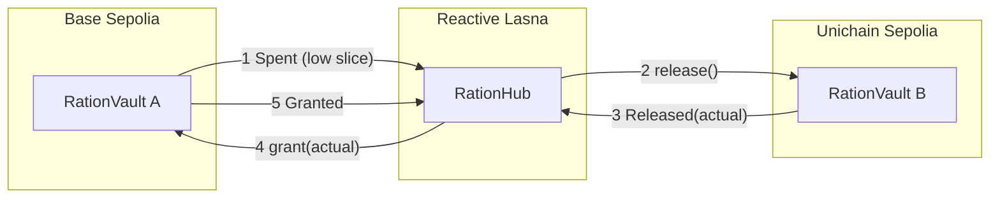

# Ration

**One spending limit that follows your spending across chains. No keeper. No custody.**

Every chain enforces its own limit, so a budget spread over several chains can quietly go over. Ration
holds one budget per period, gives each chain a *slice* of it, and a reactive contract on
[Reactive Network](https://dev.reactive.network) moves slices to the chain where spending happens.
Tokens stay in vaults you control. Only the right to spend moves.

Testnet build: Base Sepolia, Unichain Sepolia, Reactive Lasna. The token is a mock with no value.

- Live app: set after you deploy it (see "Deploy the web app")
- Proof, with every transaction hash and latency: [docs/EVIDENCE.md](docs/EVIDENCE.md)
- Proof that a forced early start never overlaps old and new slices: [docs/EVIDENCE_FORCED_START.md](docs/EVIDENCE_FORCED_START.md)
- Audit notes: [docs/AUDIT.md](docs/AUDIT.md)
- Demo script: [docs/DEMO_PATH.md](docs/DEMO_PATH.md)
- Reactive notes (what was confirmed, what surprised us): [docs/ARCHITECTURE.md](docs/ARCHITECTURE.md)

## The invariant, in plain words

> At every moment: all the slices, plus everything already spent, plus anything on its way between chains, is never more than the budget.

Slices are moved in two steps, never overwritten:

1. The chain with spare allowance **gives up** some of its slice first (`release`).
2. Only after the hub sees that, the chain that needs more **takes exactly that much** (`grant`).

Allowance is removed before it is added, so it can never be counted twice. If any message is lost or late, the budget
goes **unused** for a while. It is never overspent. Each transfer has an id, so repeated or reordered messages do nothing.
A slice also expires at the end of the period, so a chain that misses an update simply stops spending.

## How it works



| Contract | Where | What it does |
|---|---|---|
| `RationVault` | one per destination chain | Holds tokens and a slice. Approved spenders spend out of the slice. Callback-only `release`, `grant`, `resetEpoch`. |
| `RationHub` | Reactive Lasna | Reactive contract. Subscribes to every vault's events and a periodic tick. Requests the callbacks. Never touches tokens. |
| `MockUSDC` | testnets only | Worthless test stablecoin with a public faucet. |

Measured on the live testnets: spend to grant landed in **3 to 4 seconds**; an early period start (stop spending everywhere, then issue new slices) completed in **about 6 seconds**. See [docs/EVIDENCE.md](docs/EVIDENCE.md).

## Honest limits

- **Funds do not cross chains.** You fund each vault yourself. Ration decides how much of the limit each chain may spend.
- **The owner is a single key.** Lose it and vault funds are locked; there is no recovery. Use a multisig for anything real. See the audit.
- **Starting a period early** takes a few seconds: every chain must confirm it has stopped spending before new slices are issued, and new slices open ten seconds later. If a chain cannot confirm (for example it is out of fuel), the early start waits for the old period to end.
- **Fuel is needed on every chain.** The hub needs lREACT and each vault needs a little native token for callbacks. If one runs out, it pauses until topped up; the budget stays safe.
- **Testnet and a mock token.** Not audited by a third party. Do not use with real value.

## Repository layout

```
src/            Solidity: RationHub, RationVault, MockUSDC
test/           Foundry: unit tests, replay tests, stateful invariant fuzz
script/         Foundry deploy scripts
scripts/        TypeScript: prove-loop, seed (demo reset), mcp-smoke
web/            React + Vite app (8 pages + landing + connect)
packages/core   Shared spend pre-check (plain-words denial reasons)
packages/mcp    MCP server for AI agents
deployments/    Deployed addresses (read by the web app and the MCP server)
docs/           Evidence, audit, architecture notes, demo path
```

## Setup

Requirements: Node 22+, pnpm 9, [Foundry](https://book.getfoundry.sh).

```bash
git clone https://github.com/ace-coderr/ration
cd ration
git submodule update --init   # top-level libraries only: forge-std, OpenZeppelin, reactive-lib-omni
pnpm install
cp .env.example .env     # then fill in throwaway TESTNET keys only
```

### Test the contracts

```bash
forge test
```

112 tests, including the invariant fuzz (256 runs of 80 calls) with random early period starts.

### Deploy your own copy (optional, the repo already points at a live deployment)

Use throwaway keys. Fund the deployer with Base Sepolia ETH, Unichain Sepolia ETH and lREACT
(call `request(address)` with ETH on the [faucet](https://dev.reactive.network/reactive-mainnet)).

```bash
# 1. Hub on Lasna (Cron10000 = a housekeeping tick about every 3 hours; 1000 is about every 17 minutes and costs ten times more)
forge create src/RationHub.sol:RationHub --rpc-url $LASNA_RPC --private-key $DEPLOYER_PRIVATE_KEY --broadcast --constructor-args 10000
export HUB_ADDRESS=0x...   # printed above; also put it in .env

# 2. Token and vault on each destination chain (callback proxies are in docs/ARCHITECTURE.md)
PROXY=0x476F44b11F5C942c58f4c8E3d0300E5710743585 forge script script/DeployDestination.s.sol --rpc-url $BASE_SEPOLIA_RPC --broadcast
PROXY=0x775c9B990ADe401060B78D0e98684eEf8d2466C1 forge script script/DeployDestination.s.sol --rpc-url $UNICHAIN_SEPOLIA_RPC --broadcast

# 3. Register each vault with the hub, set the budget, start the first period
cast send $HUB_ADDRESS "registerVault(uint256,address,uint16,uint16)" 84532 $BASE_VAULT 5000 2000 --rpc-url $LASNA_RPC --private-key $DEPLOYER_PRIVATE_KEY
cast send $HUB_ADDRESS "registerVault(uint256,address,uint16,uint16)" 1301 $UNICHAIN_VAULT 5000 2000 --rpc-url $LASNA_RPC --private-key $DEPLOYER_PRIVATE_KEY
cast send $HUB_ADDRESS "setConfig(uint256,uint256,uint16,uint256,uint256)" 1000000000 604800 2500 300 1 --rpc-url $LASNA_RPC --private-key $DEPLOYER_PRIVATE_KEY
cast send $HUB_ADDRESS "startEpoch()" --gas-limit 1500000 --rpc-url $LASNA_RPC --private-key $DEPLOYER_PRIVATE_KEY

# 4. Fuel: hub (lREACT) and each vault (native), through depositTo on the system contract / callback proxy
cast send 0x8888888888888888888888888888888888888888 "depositTo(address)" $HUB_ADDRESS --value 10ether --rpc-url $LASNA_RPC --private-key $DEPLOYER_PRIVATE_KEY
```

Then put the addresses in `deployments/testnet.json` and `.env`.

### Prove the loop on-chain

```bash
pnpm prove-loop        # runs two live loops, writes docs/EVIDENCE.md and docs/evidence.json
pnpm seed              # fresh period for a demo, checks fuel
```

### Run the web app

```bash
pnpm --filter ration-web dev      # http://localhost:5173
pnpm --filter ration-web build    # static output in web/dist
```

### Let an AI agent spend (MCP)

```bash
pnpm --filter @ration/mcp build
pnpm mcp-smoke --spend            # real MCP client against the live contracts
```

Add the agent's address on the Spenders page, give it its own testnet key, and register the server with your MCP client:

```json
{
  "mcpServers": {
    "ration": {
      "command": "node",
      "args": ["/absolute/path/to/ration/packages/mcp/dist/mcp/src/index.js"],
      "env": { "AGENT_PRIVATE_KEY": "0x... the agent's own testnet key" }
    }
  }
}
```

Tools: `get_budget`, `get_slices`, `get_remaining`, `request_spend`, `get_ledger`. A refused spend says why in one
sentence, for example: *Exceeds slice on Base Sepolia: 99,999 requested, 325 mUSDC available here; remaining total 525 mUSDC.*
The server also serves its recent calls at `http://127.0.0.1:7373/calls` for the Agents page.

## Deploy the web app (Cloudflare Workers, static assets)

The repository includes `wrangler.jsonc`: assets directory `web/dist` with single-page-app fallback, so `/live` and `/proof` load
directly instead of returning 404. Everything is done in the dashboard:

1. Push this repository to GitHub (public).
2. Open the [Cloudflare dashboard](https://dash.cloudflare.com) and go to **Workers & Pages**.
3. Click **Create application**, then **Import a repository** (the Workers flow, not the Pages tab). Authorize GitHub and pick the repository.
4. On the setup screen:
   - **Project name:** `ration` (it must match `name` in `wrangler.jsonc`)
   - **Production branch:** `main`
   - **Root directory:** leave empty
   - **Build command:** `pnpm install --frozen-lockfile && pnpm --filter ration-web build`
   - **Deploy command:** `npx wrangler deploy`
5. Under **Variables and secrets** (build), add `NODE_VERSION` = `22`.
6. Click **Save and Deploy**. When the build finishes, open the `ration.<your-subdomain>.workers.dev` link.
7. Paste `/live` and `/proof` straight into new tabs to confirm deep links work. Put the URL at the top of this README.

Later pushes to `main` redeploy automatically.

## Built with

Solidity 0.8.29 and Foundry, `reactive-lib-omni`, OpenZeppelin 5, React, Vite, TypeScript, viem, framer-motion, and the Model Context Protocol SDK.

## License

MIT. See [LICENSE](LICENSE).
